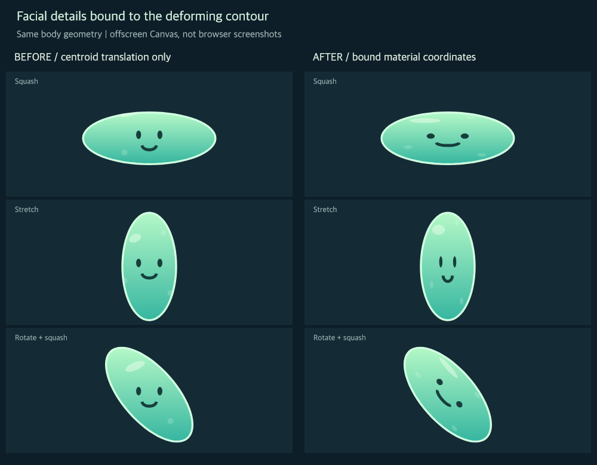
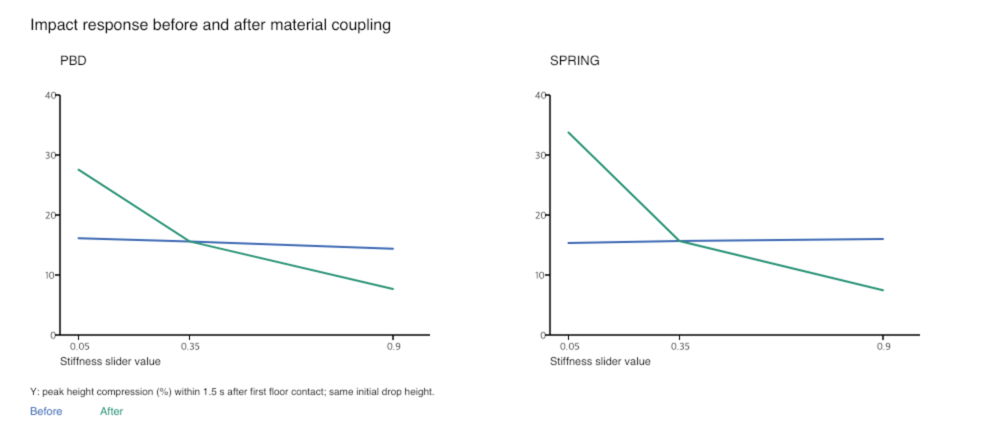

# 史莱姆穿迷宫 Slime Maze

一个可离线运行的二维软体交互动画项目。引导史莱姆挤过窄门、绕开障碍，按顺序完成四关；也可以在捏捏工作台中编辑角色形状。

## 运行

下载仓库后，双击 `dist/史莱姆穿迷宫.html`，用现代桌面浏览器打开。运行页面不需要安装依赖、启动服务或联网。

- 按住画布引导角色，松开后观察恢复过程。
- 软硬滑块、软体风格和形状恢复可以直接调整。
- 五官、高光和气泡绑定到软体轮廓，随局部挤压和拉伸变化；整体朝向稳定抑制持续转圈。
- 在两种软体风格之间切换时保留位置、形状、隐式速度和关卡进度。
- 通关后弹出提示，可进入下一关或重玩；第四关完成后可重新开始旅程。
- 自动演示按预设路线操作；按住画布可接手。
- 捏捏工作台支持控制点拖拽、形变预设和关键姿态动画。
- 录制按钮采集画布，结束后提供保存链接；重置或换关后仍保留上次录制链接。编码支持取决于浏览器。
- 在“观察细节”中勾选调试网格，可查看实际 rAF 帧率、帧间隔 P95 和平均求解耗时；后台中断会重置短时统计。

## 算法与实现

以64个轮廓粒子表示角色，使用固定步长 Verlet 预测。约束软体采用距离投影；弹簧软体采用弹簧与相对速度阻尼。两者共用面积约束、可调全局形状恢复、局部轮廓稳定化和矩形接触处理。

局部处理包括曲率平滑、短边保护与限幅的三点转角修正。先衰减95%的整体角位移分量，预测后再对超出±15°目标区间的角度作一次轻缓校正（超差的1%，限幅0.002 rad）。两项均独立于恢复开关；后续结构与接触修正仍有优先权，目标区间不是严格角度上界。碰撞检查完整轮廓线段，并在结构求解后收尾。FFD工作台使用16个控制点的平面双三次 Bernstein 映射；它是几何动画，与迷宫物理解算分开。

内部图案使用静止轮廓的平均值坐标（mean value coordinates）绑定，不向物理解算添加约束。实现入口与求解顺序见[代码导读](docs/代码导读.md)，代码风格见[编码约定](docs/编码约定.md)。

两种结构模型并不是经过材料标定的等效仿真，某些挤压过程中的拉伸方向和轮廓会不同。程序用于动画表现，不用于真实材料预测。

## 构建与检查

开发与实验使用 Node.js 22 或更新版本（本轮已测24.22.1），没有npm运行依赖，不需要先执行npm install。

```sh
npm run build
npm test
node scripts/route.js
node scripts/check-stress.js
```

`npm test` 先检查源码与脚本语法，再检查FFD与软体稳定性、碰撞、局部处理、尖角回归、原地模型切换、五官绑定、持续右拉的朝向稳定、闯关事件流程与录制状态。录制事件检查使用模拟编码器，不验证浏览器视频编码。模拟画布事件检查不代替实际浏览器视觉和手感验收。



上图为同一轮廓上的旧版与新版绘制对比，使用离屏 Canvas 生成。可选安装 `@napi-rs/canvas` 后执行 `node scripts/render-skin.js` 重建；离线程序和数值检查不需要该库。

## 可复现实验

原始JSON以 `.json.gz` 保存。先解压，再查看数据或生成分析：

```sh
npm run data:unpack
npm run experiment
node scripts/impact.js --baseline
node scripts/impact.js
node scripts/border-impact.js
npm run study
node scripts/study-summary.js
```

完整扫描含120组条件，每组预热一次、测量三次，统一粒子密度、时间步长与收尾循环，并保存核心源码指纹和采样轨迹指纹。比较基础、局部平滑、短边保护及转角限制，区分几何通过与满足采样轮廓质量标准的通过。

[阅读实验分析](results/depth-study/实验分析.md)。其中包含失败情况、采样限制、计时条件及软硬响应修正前后的对比。



图表重建可选使用 Python 与 `requirements-figures.txt` 中的 reportlab：

```sh
python3 -m pip install -r requirements-figures.txt
python3 scripts/study-figures.py
```

上一步重建SVG；可选安装 `@napi-rs/canvas` 后执行 `node scripts/rasterize-figures.js`，可重建对应PNG。

## 文件结构

- `src/`：模拟、碰撞、关卡、FFD及界面源码。
- `dist/`：可直接打开的内联脚本离线版。
- `docs/`：求解顺序、绑定方法与统计含义。
- `scripts/`：构建、检查、实验与图表生成。
- `results/`：有效实验结果、摘要与图表。

旧核心只在 `scripts/fixtures/` 中作为回归比较，不加载到运行页面。预览PNG来自同源Canvas离屏绘制，不是浏览器界面截图。

## 限制

这是简化二维动画模型，未实现完整自碰撞、连续碰撞检测或真实能量守恒；极端操作仍可能出现异常。几何质量按固定间隔采样，不证明连续时间无穿透或无折叠。核心耗时不是浏览器帧率。最终实验报告与操作录屏尚未纳入此版本。

## 参考与说明

- Müller et al., Position Based Dynamics, 2006. https://matthias-research.github.io/pages/publications/posBasedDyn.pdf
- Müller et al., Meshless Deformations Based on Shape Matching, 2005. https://matthias-research.github.io/pages/publications/MeshlessDeformations_SIG05.pdf
- Sederberg and Parry, Free-form Deformation of Solid Geometric Models, 1986.

项目采用上述方法的简化思路，自行编写求解与交互代码，未使用现成物理引擎；开发使用了大模型辅助。源码与实验可用于理解和复现，方法名称不代表实现了原论文全部内容。
