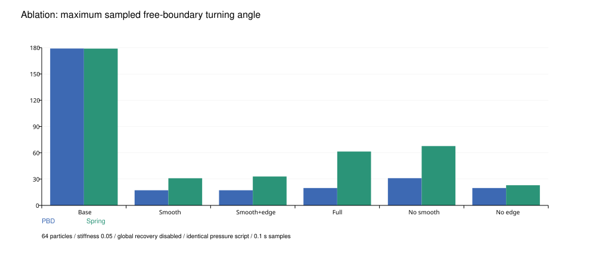
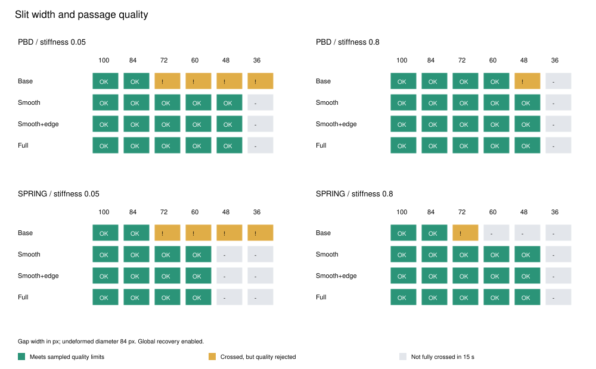
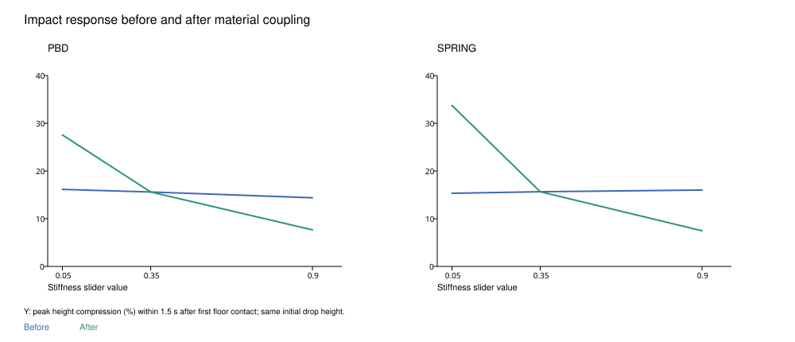

# 轮廓稳定性 窄缝通行与材质响应实验

## 实验目的

本实验研究柔软变形、形状保持和碰撞之间的取舍，并核对软硬滑块是否能产生可见的撞击差异。结果用于后续报告，不是最终报告；不以功能数量代替算法效果。

## 可复现条件

环境：{"node":"v24.22.1","platform":"darwin","arch":"arm64","cpu":"Apple M4"}。固定步长1/120秒，64个等质量粒子、相同连接、主求解8轮，保留同样的6轮收尾与接触处理。120组条件均预热一次后重复三次，三次在每0.1秒及最终采样点的完整坐标指纹一致。
所有组共用角位移衰减与预测后的一次轻缓朝向校正；该项用于角色朝向，不是自碰撞处理。所有消融组保持同样的粒子密度和循环安排。基础组仅关闭曲率平滑、短边保护和转角限制，不使用此前32粒子的旧版，以避免密度和收尾次数成为混杂变量。软硬参数同时影响结构约束与开启时的全局恢复，两种模型未做等效材料标定。

形状、面积、穿透、自由轮廓折角和自交指标每12步采样一次，加上最终状态。文中最大值是这些采样的最大值，不能保证捕获两次采样之间的短暂异常。单步耗时只围绕核心step计时，排除指标计算与渲染，取三次平均单步耗时的中位数。

## 持续挤压与消融

前6秒顶向第一面墙，6至9秒引导到窄口外侧，9秒时撤除引导和障碍，再观察6秒。折角在距障碍至少10像素的粒子上测量；自交仅计非相邻边的严格交叉，不含相切和共线重叠。

### PBD 全局恢复开启

| 配置 | 最大自由折角 ° | 最大自交数 | 最大面积偏差 % | 核心毫秒每步 |
|---|---:|---:|---:|---:|
| 基础模型 | 169.1 | 6 | 0.05 | 0.3997 |
| 仅平滑 | 16.7 | 0 | 0.53 | 0.4190 |
| 平滑＋短边 | 16.7 | 0 | 0.53 | 0.4227 |
| 完整处理 | 19.5 | 0 | 0.61 | 0.4454 |
| 去掉平滑 | 30.5 | 0 | 0.32 | 0.4652 |
| 去掉短边 | 19.5 | 0 | 0.61 | 0.4321 |

### PBD 全局恢复关闭

| 配置 | 最大自由折角 ° | 最大自交数 | 最大面积偏差 % | 核心毫秒每步 |
|---|---:|---:|---:|---:|
| 基础模型 | 179.0 | 8 | 0.05 | 0.3842 |
| 仅平滑 | 17.3 | 0 | 0.55 | 0.4095 |
| 平滑＋短边 | 17.3 | 0 | 0.55 | 0.4093 |
| 完整处理 | 19.8 | 0 | 0.62 | 0.4370 |
| 去掉平滑 | 31.1 | 0 | 0.35 | 0.4518 |
| 去掉短边 | 19.8 | 0 | 0.62 | 0.4281 |

### SPRING 全局恢复开启

| 配置 | 最大自由折角 ° | 最大自交数 | 最大面积偏差 % | 核心毫秒每步 |
|---|---:|---:|---:|---:|
| 基础模型 | 179.1 | 19 | 0.03 | 0.3663 |
| 仅平滑 | 19.4 | 0 | 0.76 | 0.3912 |
| 平滑＋短边 | 19.5 | 0 | 0.73 | 0.3993 |
| 完整处理 | 32.6 | 0 | 0.81 | 0.4203 |
| 去掉平滑 | 37.1 | 0 | 0.27 | 0.4224 |
| 去掉短边 | 18.7 | 0 | 0.86 | 0.4181 |

### SPRING 全局恢复关闭

| 配置 | 最大自由折角 ° | 最大自交数 | 最大面积偏差 % | 核心毫秒每步 |
|---|---:|---:|---:|---:|
| 基础模型 | 178.9 | 32 | 0.03 | 0.3807 |
| 仅平滑 | 31.0 | 0 | 0.91 | 0.3899 |
| 平滑＋短边 | 33.0 | 0 | 0.93 | 0.4014 |
| 完整处理 | 61.5 | 0 | 0.95 | 0.4246 |
| 去掉平滑 | 67.7 | 4 | 0.54 | 0.4305 |
| 去掉短边 | 23.0 | 0 | 0.93 | 0.4177 |

关闭全局恢复的组用于检查局部处理是否被全局恢复掩盖。基础模型中面积误差小不代表轮廓正确：有向面积无法可靠反映自交轮廓的真实占据区域，必须结合自交和折角判断。

各局部处理相互耦合，在不同模型与恢复状态下效果不同；不能据一组测试宣称每个子项始终有益。完整处理仍有计算开销，且不保证每组折角最小、完全无自交或通行宽度单调改善。

恢复阶段位于引导穿缝之后，部分组在撤力前已接近原形，原始恢复时间因此接近一个采样起点；这些值不用于比较恢复速度。恢复阈值为六个连续采样点形状误差低于2%，跨度0.5秒。



## 缝隙宽度扫描

单面厚40像素的竖墙，中心狭缝宽度分别为100、84、72、60、48、36像素；初始角色直径84像素，质心位于(170,270)。先静置1秒，再引导到(780,270)，总时长15秒，不施加重力。

完整几何通过要求所有轮廓粒子到达墙右侧x>482并持续60步。表中“通过”还要求所有采样满足面积偏差≤10%、侵入≤0.5像素、自由折角≤60°、有向面积为正且没有检测到严格自交。“形状异常”表示几何通过但未满足上述质量标准。这些是本实验的操作性阈值，不是真实材料定律或课程评分标准。“未通过”只表示15秒内未完整通过。

### PBD 软硬参数 0.05

| 配置 | 100 px | 84 px | 72 px | 60 px | 48 px | 36 px |
|---|---|---|---|---|---|---|
| 基础模型 | 通过 | 通过 | 形状异常 | 形状异常 | 形状异常 | 形状异常 |
| 仅平滑 | 通过 | 通过 | 通过 | 通过 | 通过 | 未通过 |
| 平滑＋短边 | 通过 | 通过 | 通过 | 通过 | 通过 | 未通过 |
| 完整处理 | 通过 | 通过 | 通过 | 通过 | 通过 | 未通过 |

### PBD 软硬参数 0.8

| 配置 | 100 px | 84 px | 72 px | 60 px | 48 px | 36 px |
|---|---|---|---|---|---|---|
| 基础模型 | 通过 | 通过 | 通过 | 形状异常 | 未通过 | 未通过 |
| 仅平滑 | 通过 | 通过 | 通过 | 通过 | 通过 | 未通过 |
| 平滑＋短边 | 通过 | 通过 | 通过 | 通过 | 通过 | 未通过 |
| 完整处理 | 通过 | 通过 | 通过 | 通过 | 通过 | 未通过 |

### SPRING 软硬参数 0.05

| 配置 | 100 px | 84 px | 72 px | 60 px | 48 px | 36 px |
|---|---|---|---|---|---|---|
| 基础模型 | 通过 | 通过 | 形状异常 | 形状异常 | 形状异常 | 形状异常 |
| 仅平滑 | 通过 | 通过 | 通过 | 通过 | 未通过 | 未通过 |
| 平滑＋短边 | 通过 | 通过 | 通过 | 通过 | 未通过 | 未通过 |
| 完整处理 | 通过 | 通过 | 通过 | 通过 | 未通过 | 未通过 |

### SPRING 软硬参数 0.8

| 配置 | 100 px | 84 px | 72 px | 60 px | 48 px | 36 px |
|---|---|---|---|---|---|---|
| 基础模型 | 通过 | 通过 | 形状异常 | 未通过 | 未通过 | 未通过 |
| 仅平滑 | 通过 | 通过 | 通过 | 通过 | 通过 | 未通过 |
| 平滑＋短边 | 通过 | 通过 | 通过 | 通过 | 通过 | 未通过 |
| 完整处理 | 通过 | 通过 | 通过 | 通过 | 通过 | 未通过 |

共96组缝隙条件中，几何通过76组，满足采样质量条件66组，几何通过但形状不合格10组。不能把折叠或自交后挤到另一侧当作成功。

每种配置各24组缝隙条件：基础模型几何通过19组，质量通过9组；仅平滑几何通过19组，质量通过19组；平滑＋短边几何通过19组，质量通过19组；完整处理几何通过19组，质量通过19组。各项作用仍需结合持续挤压轮廓和计算开销判断。

通行由驱动、结构、恢复、朝向稳定和局部处理共同决定。仅测试离散宽度，不能将单档结果推广为真实材料定律；两分支也未经等效材料标定。



## 软硬滑块与撞击形变

原版所有档位使用相同的全局恢复系数0.012，固定保形处理使撞地差异很弱。现在开启形状恢复时，每轮系数改为 alpha=0.001+0.011×(k/0.35)²，默认k=0.35仍为0.012。关闭该开关后，此恢复项同样关闭；抗折和接触处理仍保留。

固定初始质心(480,100)、半径42像素、重力650，比较首次接触地面后1.5秒内的最小高度。这里测量的是形变，不是恢复系数、能量守恒或真实材料弹性。

| 模型 | 软硬参数 | 修正前最小高度 px | 修正后最小高度 px | 修正后最大宽度 px |
|---|---:|---:|---:|---:|
| PBD | 0.05 | 70.44 | 60.86 | 109.50 |
| PBD | 0.35 | 70.89 | 70.89 | 95.36 |
| PBD | 0.9 | 71.91 | 77.57 | 87.10 |
| SPRING | 0.05 | 71.12 | 55.66 | 121.90 |
| SPRING | 0.35 | 70.85 | 70.85 | 95.43 |
| SPRING | 0.9 | 70.55 | 77.72 | 86.89 |

地面、顶边、左右边框共24组检查均验证了软、中、硬三档在碰撞法向上的最小尺寸按预期递增。侧边与顶边使用相同初始位移速度发射，地面使用同高重力落下；每个方向内比较，不能将四个方向的绝对数值直接视为同一冲击强度。



## 限制与结果边界

- 这些是确定的单角色二维动画测试，不是对任意用户操作的稳定性证明。
- 质量检查按0.1秒采样；自交检查不覆盖相切、重合及连续时间事件。
- 有向面积在自交时不等于实际占据面积，因此同时报告轮廓几何问题。
- 碰撞投影、速度限幅、几何平滑与全局恢复都改变能量，不用于材料参数反演。
- 时间结果来自本机离线核心，固定条件顺序运行，受JIT、机器负载和温度影响；不能代替浏览器帧率与实际手感验收。
- 恢复段不构成有效的恢复速度对比；本轮主要结论来自轮廓稳定性、缝隙通行和同高撞击。
- 缝隙只测试六个离散宽度；某宽度通过而更窄一档未通过，不证明已找到精确的最小可通宽度。

## 复现

项目目录执行：
```sh
node scripts/check-ablation.js
node scripts/impact.js --baseline
node scripts/impact.js
node scripts/border-impact.js
node scripts/depth-study.js
node scripts/study-summary.js
```

数据实验只需Node.js；可选图表生成使用Python reportlab执行scripts/study-figures.py。study.json保留条件、环境、核心源码SHA256、原始指标与代表帧；summary.csv用于快速查看，runs.jsonl保留每组的独立记录。
